<p align="center">
  
</p>

<h1 align="center">CoReader</h1>

<p align="center">面向英文论文的 Windows & macOS 液态玻璃 PDF 阅读器</p>

<p align="center">
  <a href="https://github.com/YuboCoco/CoReader/releases/latest">版本发布</a> ·
  <a href="#核心功能">核心功能</a> ·
  <a href="#工作区与伴读卡片">工作区与伴读</a> ·
  <a href="#主题与液态玻璃">主题图集</a> ·
  <a href="#开始使用">开始使用</a> ·
  <a href="#模型与账号">模型与账号</a> ·
  <a href="#从源码构建">源码构建</a>
</p>

CoReader 将**本地论文库、离线双语对照、划词批注、多模型 AI 助读**与**伴读工作区**融于一体。导入 PDF 即可离线阅读、搜索、高亮批注并调用内置本地模型进行双语翻译；接入自己的大模型账号后，还可围绕原文提问、生成整篇论文分析、整理参考文献并解析图表与公式。

[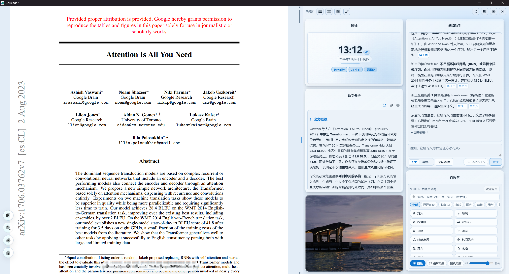](docs/screenshots/showcase-hero.png)

*CoReader 界面实拍。左侧展示 PDF 原文，右侧双列功能栏可同时呈现液态玻璃时钟、论文分析、带页码跳转的阅读助手、轮播相册与 SoftEcho 白噪音。示例论文为 Vaswani 等人发表于 NeurIPS 2017 的 [Attention Is All You Need](https://arxiv.org/abs/1706.03762)。*

---

## 核心功能

### 双语对照阅读 & 本地离线翻译

- **原文与译文联动对照**：支持翻译单段、本页、本章或整篇论文，并可在「阅读设置」中开启**打开文章后自动翻译全文**。对照模式下左侧原文页面自动居中显示，悬停段落时原文与译文同步高亮，支持单段重译与原文定位。
- **保留插图、表格与独立公式**：借助本地版面识别模型，从原 PDF 中裁切的插图、表格与独立公式会按阅读顺序自然嵌入中文译文流中，对照阅读不跳戏。
- **开箱即用离线翻译**：Windows 与 macOS 安装包和便携包均随包内置 **Haidass-Translate-143M** 与腾讯 **Hy-MT2-1.8B** 两款离线模型，纯 CPU 即可断网运行，也可切换为任意云端大模型。

| 浅色双语对照（译文保留原图与段落联动） | 深色双语对照（Hy-MT2-1.8B 离线翻译） |
| --- | --- |
| [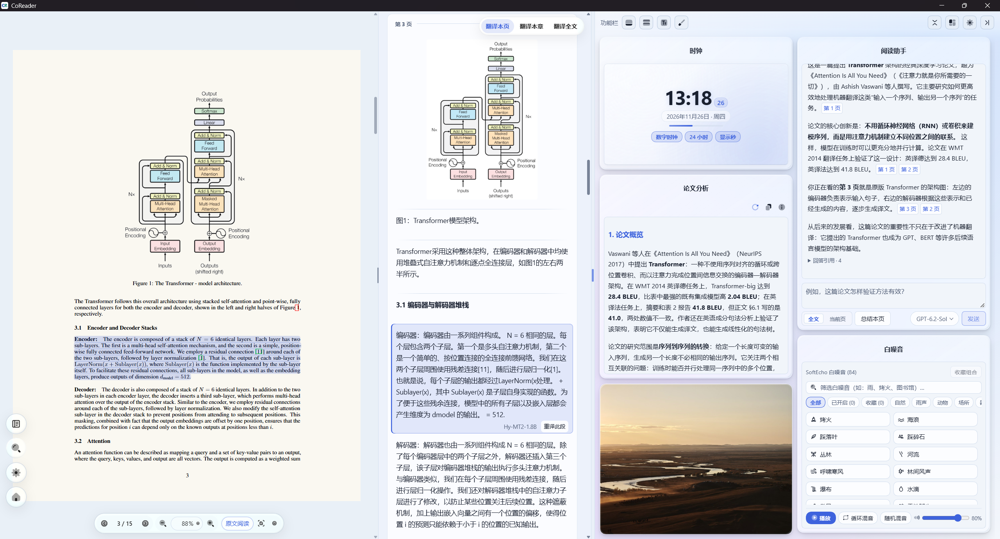](docs/screenshots/bilingual-figures.png) | [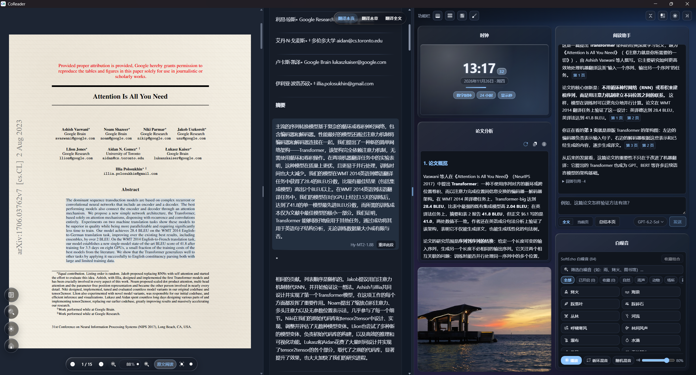](docs/screenshots/bilingual-dark.png) |

### 划词翻译、高亮批注与术语解释

- **液态玻璃划词工具条**：选中 PDF 文本即弹出多色高亮、添加批注、划词翻译、术语解释与「引用至阅读助手」快捷按钮；按住 `Shift` 可跨段追加选区一次翻译。
- **并排划词浮窗**：译文浮窗以液态玻璃材质呈现，支持编辑英文原文、调节字号、一键复制译文，所有高亮、批注与术语记录均按论文自动归档至对应功能卡片。

[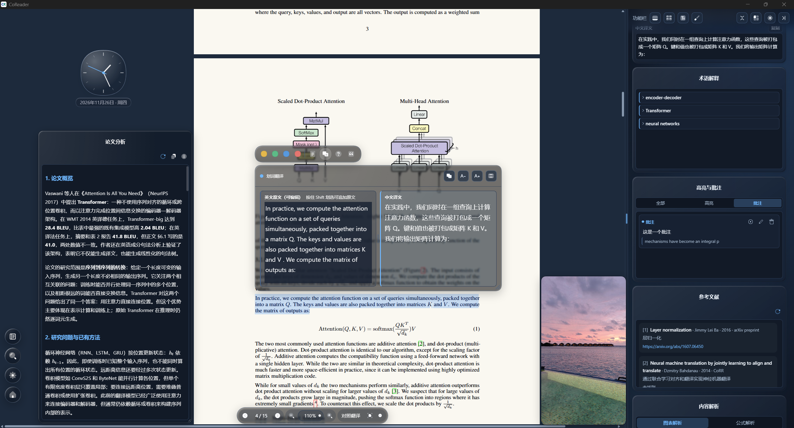](docs/screenshots/selection-floating.png)

### AI 阅读助手、论文分析与内容解析

- **阅读助手**：围绕当前页或全文检索提问，支持划词引用多段原文；回答中的页码标记可直接点击跳回 PDF 对应页，对话历史按论文独立保存。
- **论文分析**：一键生成涵盖论文概览、研究问题、方法设计、实验结论与局限性的结构化报告；长文自动分段处理后汇总，并记录所用模型、推理强度与覆盖页码。
- **参考文献整理**：提取书目信息与中文译名，优先保留原文 DOI / 链接并自动补全缺失链接。
- **图表与公式解析**：悬停、右键或框选 PDF 中的插图、表格与数学公式即可发起解析，结果保存在「内容解析」卡片中，支持按位置或时间排序。

### 论文库与阅读进度

- 支持拖放 PDF、导入单篇文献或递归导入整个文件夹；通过多级分类、自定义标签与阅读状态高效管理文献。
- 支持编辑标题、作者、年份、出处、DOI 与摘要，提供列表/表格双视图与全文检索，每次打开自动回到上次阅读页码。

---

## 工作区与伴读卡片

### 11 种模块化卡片 & 伴读生态

功能栏内置 **11 种可自由开关与编排的卡片**，覆盖文献精读与桌面伴读全流程：

[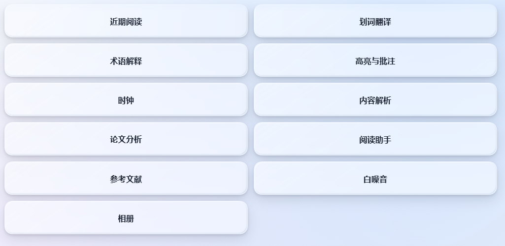](docs/screenshots/workspace-cards.png)

- **液态玻璃时钟**：支持数字时钟与模拟指针两种样式，可切换 12/24 小时制与秒针显示；悬浮放置时自动隐去边框与底色，长按可直接拖动，点击即可恢复完整卡片。
- **轮播相册卡片**：内置精选初始风景照片，也可选择本地照片文件夹并可视化点选单张、多张或整夹轮播；支持**预设及自定义秒数轮播时长**、**顺序/随机轮播**以及 **6 种过渡切换动效**（柔和淡入、电影推镜、景深虚化、视差滑入、光圈展开、斜切幕布），展示照片时自动隐去顶栏以获得纯净视野，右键菜单可直达相册设置。
- **SoftEcho 白噪音**：内置 **84 种带独立图标的环境音轨**（自然、雨声、动物、场所、器物、交通等），支持**多音轨同时混音**与独立音量滑块、循环/随机混音、**收藏当前混音组合**（支持一键启用、重命名与删除），也可加载本地自定义音频文件夹。

[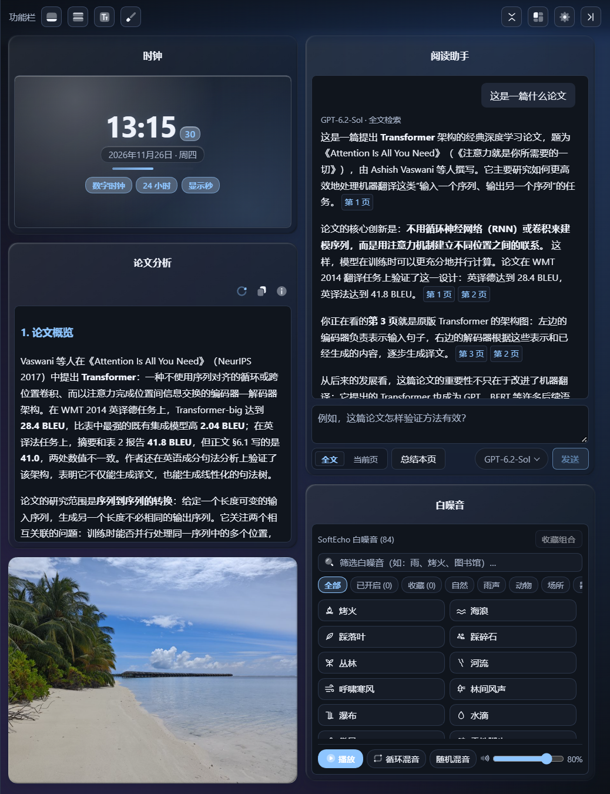](docs/screenshots/workspace-sidebar.png)

### 自由悬浮卡片与多位置停靠

- **自由拖拽悬浮**：任意功能卡片均可从功能栏拖出，在阅读区自由摆放与调整大小；拖回功能栏时顶栏自动适配栏宽，并附带对齐插入线与避让动效。
- **灵活停靠布局**：默认采用右侧双列功能栏（左列：时钟、论文分析、相册；右列：阅读助手、白噪音），也支持停靠于**左侧、右侧（单列 / 双列）或底部**，可一键全部折叠/展开，并支持保存最多 3 套自定义工作区布局随时切换。
- **多页阅读与便捷控制**：支持单页与双页并排阅览、左下角平滑滑出文献目录与文内搜索、顶部/底部阅读胶囊快捷调整缩放与对照模式。

| 卡片自由悬浮工作区 | 双页阅览 + 底部横向功能栏 |
| --- | --- |
| [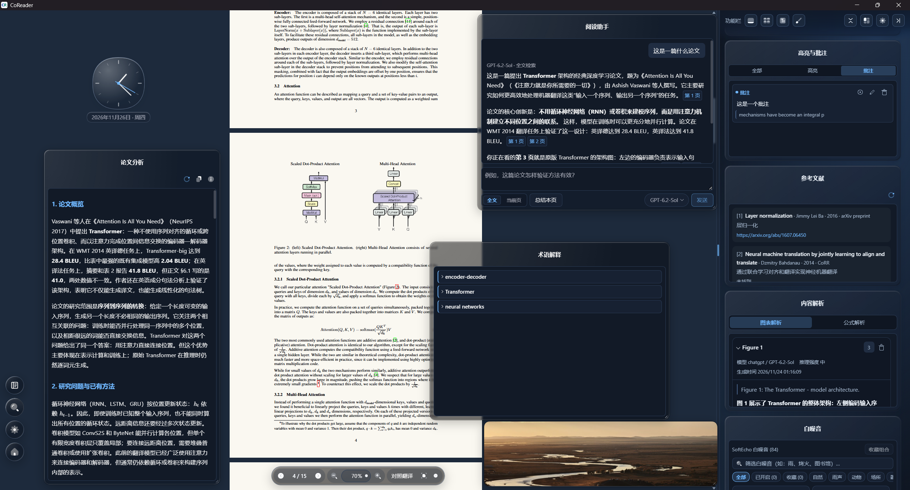](docs/screenshots/floating-workspace.png) | [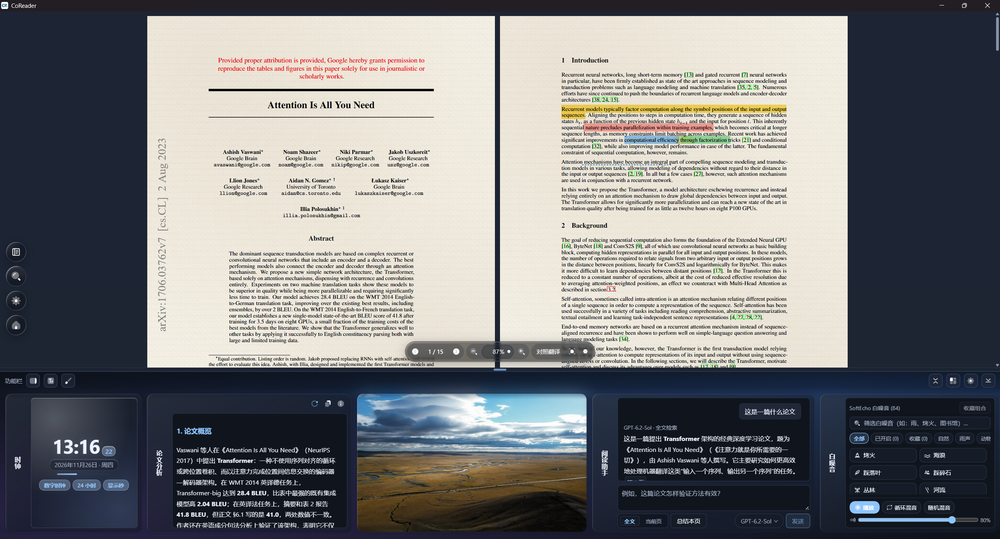](docs/screenshots/dock-bottom-showcase.png) |

---

## 主题与液态玻璃

CoReader 采用可自适应对比度的 **液态玻璃（Liquid Glass）** 视觉材质，可在「显示设置」中自由开关并精细调节浅色/深色玻璃着色强度。内置多款浅色、深色、双拼与动态流光主题（`晴光流彩`、`极夜流光`），并支持 **5 款夜间护眼深色 PDF 纸面**（`玄夜深灰`、`深夜靛蓝`、`暖墨褐纸`、`墨绿夜读`、`极夜纯黑`），在暗光反色阅读的同时保持彩图与标注色相自然。

| 深海子夜 · 深夜靛蓝 | 蔷薇薄雾 · 纸张纹理 |
| --- | --- |
| [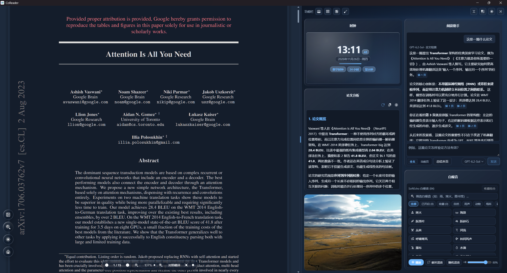](docs/screenshots/theme-showcase-1.png) | [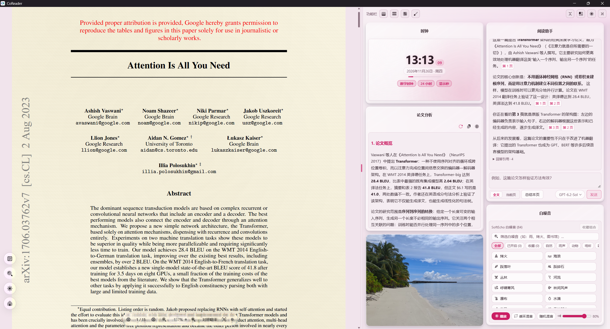](docs/screenshots/theme-showcase-2.png) |

| 山间松雾 · 浅青绿 | 深海子夜 · 柔白 |
| --- | --- |
| [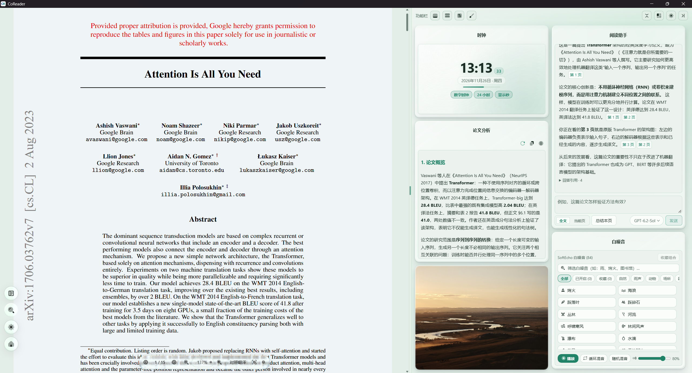](docs/screenshots/theme-showcase-3.png) | [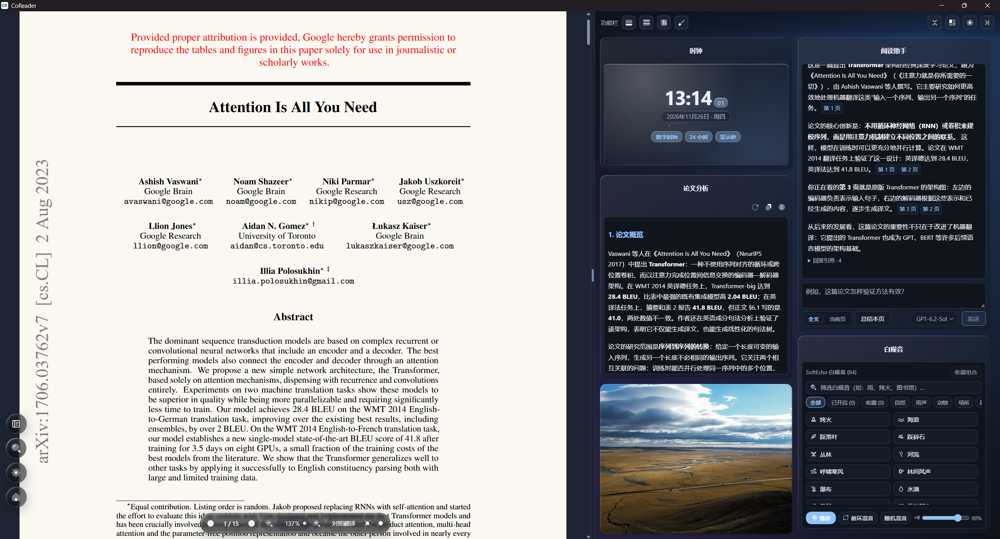](docs/screenshots/theme-showcase-4.png) |

| 暮紫星河 · 柔白 | 极夜流光 · 深夜靛蓝 |
| --- | --- |
| [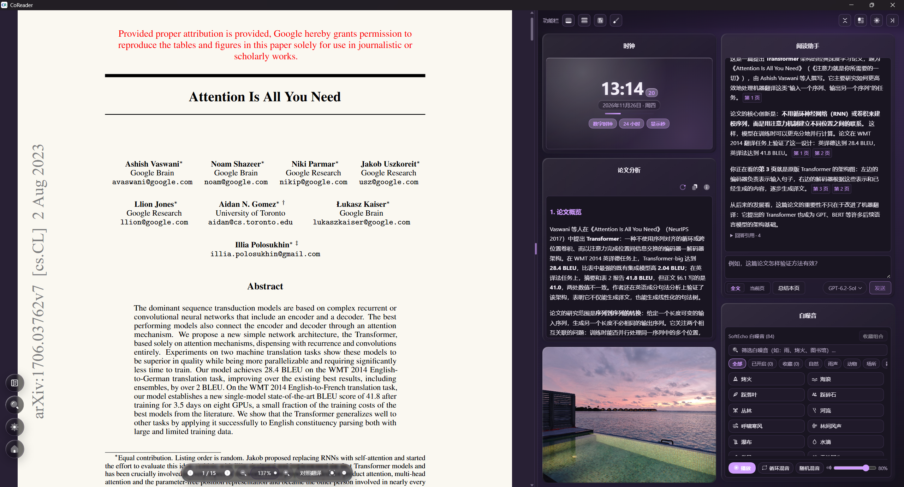](docs/screenshots/theme-showcase-5.png) | [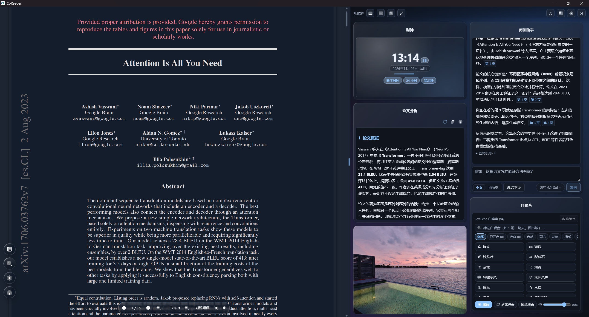](docs/screenshots/theme-showcase-6.png) |

---

## 开始使用

1. **安装或解压**
   - **Windows 10/11 x64**：安装版运行下载的 EXE，便携版完整解压后双击 `CoReader.exe`。[下载安装版](https://github.com/YuboCoco/CoReader/releases/download/v0.1.5/CoReader-0.1.5-Setup-win-x64.exe) · [下载便携版](https://github.com/YuboCoco/CoReader/releases/download/v0.1.5/CoReader-0.1.5-win-x64.zip)
   - **macOS 13.3 及以上**：按处理器架构下载对应 ZIP，完整解压后打开 `CoReader.app`。支持 macOS 原生菜单、窗口按钮及 `⌘O` 打开 PDF，数据保存在 `~/Library/Application Support/English Lit Reader`。[下载 Apple Silicon 版](https://github.com/YuboCoco/CoReader/releases/download/v0.1.5/CoReader-0.1.5-mac-arm64.zip) · [下载 Intel 版](https://github.com/YuboCoco/CoReader/releases/download/v0.1.5/CoReader-0.1.5-mac-x64.zip)（GitHub 上的 macOS ZIP 使用临时签名，尚未进行 Apple 公证。）
2. **打开论文**
   - 首次启动内置示例论文《Attention Is All You Need》与交互式新手引导；可在首页左侧点击「打开 PDF」或「从文件夹导入」建立个人论文库。
3. **翻译与助读**
   - 划词或开启对照即可直接使用随包附带的离线翻译模型；如需 AI 问答、论文分析或图表解析，进入「设置 → 模型与账号」连接服务商并选择问答模型。

版本号可在首页左下角或设置面板查看；启动时会自动检查 GitHub 新版本并在有更新时提示。

---

## 模型与账号

设置窗口以支持触摸板左右滑动与拖拽的 **3D 卡片环** 直观展示各模型服务商的连接状态与余额/配额快照，问答与翻译可按任务独立指定模型与推理强度：

| 接入方式 | 说明 |
| --- | --- |
| **ChatGPT 订阅** | 在 ChatGPT 卡片中发起连接，于系统浏览器完成授权。可用模型取决于账号权限。 |
| **DeepSeek、GLM** | 填写对应平台 API Key，验证后保存。DeepSeek 支持查询 API 余额。 |
| **Claude** | 从连接设置跳转 Claude Console 获取 API Key 后回到 CoReader 验证，请求后可查看限流余量。 |
| **Kimi** | 同一卡片内支持切换「Kimi API」（配置开放平台 Key 并查余额）与「Kimi Code」（配合新版 [Kimi Code CLI](https://www.kimi.com/code/docs/kimi-code-cli/guides/getting-started) 浏览器授权）。 |
| **火山方舟** | 填写方舟 API Key 读取豆包模型目录，或填写已开通的 Model ID / 推理接入点 ID 验证。 |
| **WorkBuddy** | 登录 [CodeBuddy CLI](https://www.codebuddy.cn/docs/cli/quickstart) 后，点击「检测 CodeBuddy CLI 账号」。 |
| **自定义 API** | 填写任意 OpenAI 兼容的 Base URL、可选 API Key 及模型 ID，支持 HTTPS 与本机回环 HTTP。 |
| **离线翻译** | 在「任务模型 → 翻译」选择内置离线模型（Haidass-Translate-143M / Hy-MT2-1.8B），无需任何账号。 |

---

## 离线使用与本地数据

- **离线可用**：论文导入与分类、PDF 全文搜索、高亮批注、内置离线翻译，以及查看所有已保存的译文与分析记录均完全本地运行。
- **联网功能**：仅在调用云端模型、参考文献补链或检查 GitHub 版本更新时发起网络请求。
- **备份与卸载**：Windows 默认数据目录为 `%APPDATA%\English Lit Reader`（PDF 位于 `papers/`，元数据位于 `library.sqlite`）。备份前先关闭应用再复制整个目录；卸载软件不会删除个人阅读数据。

---

## 从源码构建

需要 **Node.js 24**。从源码启动时可先运行 `npm run dev` 预览界面，再按需下载离线模型资源：

```powershell
git clone https://github.com/YuboCoco/CoReader.git
cd CoReader
npm ci
npm run dev
```

### Windows x64

```powershell
npm run prepare:translation:win
npm run prepare:layout:win
npm test
npm run package:win
```

打包产物写入 `release/`，同时生成 `CoReader-latest/` 供直接运行。安装 **Inno Setup 6.7+** 后运行 `npm run installer:win` 可生成 Windows 安装程序（若 `ISCC.exe` 不在 `PATH` 中，可通过 `COREADER_ISCC` 指定路径）。打包后可运行 `node scripts/smoke-win.mjs` 进行桌面集成测试。

### macOS

在 macOS 上运行以下命令（可向准备资源与打包脚本传入相同的 `arm64` 或 `x64` 指定架构）：

```sh
npm run prepare:translation:mac
npm run prepare:layout:mac
npm test
npm run package:mac
```

构建生成 `.app`、便携 ZIP 与 DMG，可通过 `node scripts/smoke-mac.mjs release/CoReader-darwin-$(node -p process.arch)/CoReader.app` 进行验证。

### 技术栈与目录结构

CoReader 基于 **Electron、React、Vite、PDF.js、SQLite** 构建，离线翻译采用本地 **llama.cpp** 运行时，PDF 版面识别使用 **ONNX Runtime**。

| 目录 | 内容 |
| --- | --- |
| `src/renderer/` | 论文库、PDF 阅读、双语对照、功能卡片与设置界面 |
| `src/` | Electron 主进程、Preload、文献存储、模型接入与分析逻辑 |
| `scripts/` | 离线模型准备、Windows / macOS 打包与桌面验证脚本 |
| `test/` | 解析、存储、模型适配与相册等单元测试 |

---

## 致谢与许可

- 本项目源码采用 [MIT 许可证](LICENSE)。
- 界面字体采用小米 **MiSans**（源码构建默认使用系统字体，将 `MiSansVF.ttf` 放入 `assets/fonts/` 后随包嵌入；见 [MiSans 官方下载与许可](https://hyperos.mi.com/font/en/download/)）。
- 离线模型资源见 [Haidass-Translate-143M GGUF](https://huggingface.co/umeiko/Haidass-Translate-143M-GGUF)、[Hy-MT2-1.8B GGUF](https://huggingface.co/tencent/Hy-MT2-1.8B-GGUF) 与 [版面模型许可](assets/layout-licenses)。
