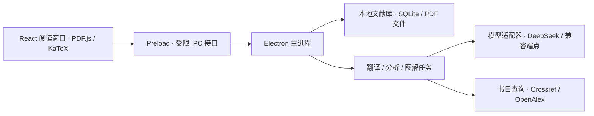

# CoReader

## Windows x64 正式版 0.1.0

双击 `CoReader-0.1.0-Setup-win-x64.exe` 安装到当前用户。安装程序会创建开始菜单快捷方式，也可选择创建桌面快捷方式。可从 Windows「设置 → 应用 → 已安装的应用」、开始菜单或安装目录里的 `unins000.exe` 卸载。卸载保留论文库、批注、阅读进度和模型设置。

便携版可解压 `CoReader-0.1.0-win-x64.zip` 后运行 `CoReader.exe`。由预览版升级前请先关闭旧窗口。正式版沿用当前 Windows 用户的阅读数据。

- **阅读界面**沿用插件布局和操作，包括右侧与底部停靠、浮动卡片、Shift 连翻、术语气泡、主题与纸张配色。顶部只保留「设置」入口，模型账号、任务模型、显示设置和功能栏列数统一在设置页管理。
- **首页论文库**支持从文件夹批量导入 PDF（含子文件夹）、搜索、阅读状态和进度。列表和表格均显示读到的最远页所对应的进度，读到最后一页时显示「已读」。可创建多级分类，批量移动或移出已选论文，并在详情中选择已有标签或创建新标签。
- **功能工作区**将论文分析、参考文献、内容解析、阅读助手与划词翻译等工具放在独立卡片里。右侧单栏与双栏会自动预留宽度，卡片可以拖动排序、悬浮或重新停靠。可一键缩小全部卡片，再逐个展开，也可保存并切换自定义布局。整栏收起后，可点击贴边的「功能栏」唤回。底部工作区支持横向滚动，术语解释、高亮与批注卡片使用左侧列表、右侧详情布局。
- **目录与对照翻译**在 PDF 工具栏打开。目录使用原生书签，缺少书签时本地识别章节标题或提供页码。目录保留原文章节编号。对照模式两侧悬停高亮，对照阅读使用内置的 PP-DocLayoutV3 在本机识别图、表和公式的区域，再按页裁切并插入译文。图表内的标签和公式保留在原图内。可翻译单段、本页、本章或全文，已有译文保存到本机。 [功能参考 NeoRead](https://github.com/cynicalight/NeoRead/blob/main/docs/pdf-translation.md)
- **离线翻译**内置 Haidass-Translate-143M Q8_0 和腾讯 Hy-MT2-1.8B Q4_K_M。默认使用 Haidass，可在「模型设置 → 任务模型 → 翻译」切换，划词翻译和 PDF 对照翻译共用此设置。两款模型都可在 Windows x64 上使用 CPU 离线运行。也可选问答模型或独立配置联网翻译。 [Haidass 模型](https://huggingface.co/umeiko/Haidass-Translate-143M-GGUF) · [Hy-MT2 官方权重](https://huggingface.co/tencent/Hy-MT2-1.8B-GGUF)
- **阅读助手**在当前 PDF 上连续提问，可引用多个选段、总结本页或全文检索。回答边生成边显示，可停止。对话按文献保存在本地，点击回答中的页码可回到 PDF。阅读助手使用设置页中选定的问答模型，全文匹配在本机完成，只把相关片段和近期对话交给所选模型。 [交互参考 NeoRead](https://github.com/cynicalight/NeoRead)
- **论文分析**优先根据上下文预算分析全文。长文按完整范围分段，保存分段笔记并支持仅重试汇总。可从内容区右上角查看模型、推理强度、时间和分析范围，也可展开查看报告中的 Markdown 表格与公式。
- **参考文献**通过模型识别带行号的书目片段，并在原文中核对字段和标识。缺失链接由 Crossref 和可选的 OpenAlex 补查。待处理、待确认和暂时失败有各自的状态。
- **内容解析**支持从 PDF 原文悬停按钮或右键菜单解析图片、表格与公式。结果按论文存档，可在「图表解析」和「公式解析」中切换，并按文中位置或生成时间排序。
- **模型设置**通过左右箭头切换等高的账号摘要卡片。点击卡片打开连接详情，可管理 ChatGPT、DeepSeek、Kimi、GLM、Claude 和 WorkBuddy。GLM 使用智谱开放平台 API Key，Claude 连接详情可在浏览器打开官方 Console 创建 API Key，再回到阅读器验证密钥。DeepSeek 和 Kimi 卡片显示平台余额，Claude 卡片显示最近请求的限流余量。DeepSeek 和 Kimi 的 API Key 在通过目录验证后保存，ChatGPT 使用浏览器授权。问答、翻译和顶栏只列出已连接账号返回的模型。 [ChatGPT 订阅接入文档](https://developers.openai.com/siwc/token-sharing-open-source) · [Kimi API 文档](https://platform.kimi.ai/docs/get-your-api-key)

账号卡片使用服务商的公开图标素材。 [ChatGPT](https://chatgpt.com/) · [DeepSeek](https://www.deepseek.com/) · [Kimi](https://github.com/MoonshotAI/Branding-Guide) · [WorkBuddy](https://www.workbuddy.cn/)

正式安装包的界面采用小米 MiSans 字体。公开源码可直接构建并使用系统字体。本地构建可从小米官网下载 MiSans，把 `MiSansVF.ttf` 放入 `assets/fonts/` 后重新构建。 [MiSans 官方下载和许可](https://hyperos.mi.com/font/en/download/)

WorkBuddy 使用官方 CodeBuddy CLI 当前登录的账号。在 WorkBuddy 卡片点击「检测本机账号」，阅读器读取当前会话可用的模型。换号后可以刷新模型目录。 [CLI 登录方式](https://www.codebuddy.ai/docs/cli/quickstart)

开发环境使用 Node.js 22.12 或更高版本。运行 `npm ci` 安装依赖，`npm run dev` 启动本地版本。运行 `npm run prepare:translation:win` 和 `npm run prepare:layout:win` 下载并校验离线模型和 CPU 引擎，`npm run package:win` 生成包含模型的 Windows x64 便携包。使用 Inno Setup 6.7 或更新版本运行 `npm run installer:win` 可同时生成安装程序。若 `ISCC.exe` 不在 PATH 中，设置 `COREADER_ISCC` 指向编译器。可将 `COREADER_INNO_ZH` 设为官方简体中文 `.isl` 文件的路径。运行 `npm test` 测试数据和模型逻辑，打包后可运行 `node scripts/smoke-win.mjs` 实际启动 EXE 做集成验证。

连接、换号或断开账号后，阅读器会更新可用模型列表。切换模型时同步显示支持的推理强度。离线翻译无需连接账号。

## 原始开发方案

## 目标与首版范围

做成一个可直接启动的 Windows 桌面软件。用户打开本地 PDF 即可阅读、搜索、批注，配置自己的模型服务后可使用翻译、术语、公式、插图、全文分析和参考文献整理功能。桌面版有独立的源码、构建产物、应用标识和数据目录。

首版按 Windows x64 规划。离线时可以打开 PDF、检索文字层、做批注、查看已有分析；模型功能是否需要联网取决于配置的服务，外部书目查询需要联网。扫描版 PDF 仍可阅读和框选图片，文字层相关操作所需的 OCR 可在后续增加。

## 技术选型

| 方案 | 迁移代价与取舍 |
| --- | --- |
| **Electron + React** | 推荐。现有 UI、PDF.js 和 Node.js 分析逻辑可以沿用。应用自带 Chromium 和 Node.js，干净的 Windows 环境可以直接运行。安装体积和运行占用较大，需要实测 PDF 性能。 |
| Tauri + React | 适合将安装体积放在首位。Windows 使用 WebView2，需要重新评估 PDF 交互和渲染差异，并为现有 Node 端实现新的服务边界。 |
| 浏览器页面 + 本地服务 | 适合快速验证阅读和接口。面向普通用户时仍需解决服务启动、端口、文件入口及打包，作为桌面版的过渡原型价值有限。 |

首版选择 Electron，使用 React 渲染阅读器，Vite 构建前端，Electron Forge 打包 Windows 安装程序。尽早用小样验证 PDF worker、SQLite 驱动和安装包三者在目标 Electron 版本上能一起运行，再锁定实际版本。 [Electron 运行时](https://www.electronjs.org/docs/latest) · [Windows 安装包](https://www.electronforge.io/config/makers/squirrel.windows) · [Tauri Windows 安装器](https://v2.tauri.app/distribute/windows-installer/)

## 现有代码怎么迁移

| 当前入口 | 可复用部分 | 独立版需要替换的依赖 |
| --- | --- | --- |
| `client.js` | PDF.js 阅读与框选、主题、选中翻译、Shift 连翻、卡片停靠和浮动、文内搜索、高亮与批注界面 | 去掉 `window.__ModuleLoader__` 与 Harness 的会话和侧栏插槽，用 React 应用入口直接挂载。把语言资源、主题变量和对 `/plugins/english-lit-reader/` 的请求拆出去。 |
| `index.js` | 翻译、术语、公式、图解、参考文献识别与匹配的提示词和逻辑 | 把 `webServer.register` 路由拆成可直接调用的业务函数。通过独立的模型适配层接替 `llm.stream`、模型目录、默认模型和推理档位。 |
| `paper-analysis.js` / `paper-planning.js` | 全文预算估算、完整分段、笔记恢复、参考文献扫描窗口与页码定位 | 保留模块和现有测试，接入独立版的模型能力与本地任务存储。预算未知时保守分段，并明确显示实际分析范围。 |
| `vendor/` | PDF.js、worker、KaTeX 和字体资源 | 资源随软件打包，确认正式构建的 URL 和 worker 路径。先对现有版本做回归，发行前核查维护版本和安全修复，验证兼容性后升级。 |
| `localStorage` / IndexedDB | 旧版数据格式、每篇论文的分析与批注关联、阅读进度 | 改为本地文献库。现在的 PDF 字节缓存有 60 MiB 上限，桌面版用文件存 PDF、用数据库存索引和结果，并补上备份与迁移。 |
| `attachments.saveImage` | PDF 页内截图、附近图注和正文抽取 | 用所选模型的图像请求格式直接发送框选区域。通过能力配置和实际探测决定是否启用图解。 |

迁移以当前工作区功能为基线，包含刚加到翻译卡片和内联浮窗的「解释术语」入口，以及点击后词条立即入列的行为。开工时记录基线提交和已有未提交改动，便于逐项对照。

## 应用结构



- **界面进程**负责打开界面、PDF 渲染和选区交互。通过 preload 请求打开文件、保存记录、执行或取消任务；任务进度和结果按请求与论文标识返回。
- **主进程**负责文件、数据库、密钥和外部请求。用明确的 IPC 方法绑定参数和来源校验，开启上下文隔离、渲染器沙箱及内容安全策略。外部文献链接交给系统浏览器，论文内容和模型 Markdown 按不可信输入渲染。 [Electron IPC](https://www.electronjs.org/docs/latest/tutorial/ipc) · [Electron 安全指南](https://www.electronjs.org/docs/latest/tutorial/security)
- **模型适配层**统一流式文本、完成原因、可用时的用量、错误与取消语义。实际模型 ID、名称、上下文窗口、输出预算、图像能力和推理档位由各端点单独配置或核实。报告和图解保存实际调用时的配置快照。
- **文献库**保存论文、阅读位置、选区锚点、批注、术语、图解、参考文献和任务快照。PDF 使用独立文件，文献编号与原文件路径解耦，相同内容按内容哈希去重。同名不同版本分别保存。

## 还需要补开发的功能

| 优先级 | 模块 | 新增工作与验收点 |
| --- | --- | --- |
| P0 | **桌面程序入口** | 创建独立应用窗口，接入文件选择、拖入 PDF、应用菜单、快捷键、全屏及窗口状态恢复。PDF.js worker 和 KaTeX 在发布包中可离线加载。 |
| P0 | **模型设置与直连** | 首版提供 DeepSeek 官方端点及可手动配置的 OpenAI-compatible Chat Completions 端点。设置页包含服务商、API 地址、API Key、模型、推理强度与连接测试。模型列表不可用时允许手动填模型 ID，能力未知时避免默认启用图像输入。 [DeepSeek 接入文档](https://api-docs.deepseek.com/en/) · [DeepSeek Chat Completions](https://api-docs.deepseek.com/api/create-chat-completion/) |
| P0 | **密钥和请求边界** | API Key 由用户输入，主进程使用 Electron `safeStorage` 加密后本地保存。界面只读到配置状态，备份和日志剔除密钥。设置页说明启用云模型时会发送原文或框选图片。 [Electron safeStorage](https://www.electronjs.org/docs/latest/api/safe-storage) |
| P0 | **本地文献库** | 提供导入、近期阅读、重复识别、持久化批注和历史结果。支持中文路径、缺失文件提示、可恢复写入和数据库版本升级。对大 PDF 按需加载页面，全文提取放到用户发起分析时。 |
| P0 | **任务与错误恢复** | 打通选中翻译和术语解释，统一超时、取消及可区分的认证、限流、网络、上下文错误。解释任务开始时立即入列。切换论文、关闭词条或重跑时，晚到结果只能更新仍有效的对应记录。 |
| P0 | **独立运行验证** | 产出 Windows x64 测试包，在无 Harness、无单独 Node.js 的环境启动。无模型配置时先打开 PDF 并正常阅读、搜索、批注和重启恢复。配置一个端点后验证真实的翻译与术语解释。 |
| P1 | **全文分析与书目** | 迁移六部分分析报告，按实际预算做全文直读或完整分段，保存分段笔记和覆盖范围以供重试。迁移参考文献逐批识别与链接验证，按服务实际配置处理配额、缓存和降级，区分待处理、待确认与查询失败。 |
| P1 | **图解释与阅读功能齐备** | 迁移公式、截图图解、图解排序和历史。图解只提交框选区域与相关图注，记录模型、强度和时间。回归卡片浮动、缩放、停靠、原译文对照以及主题和独立纸色。 |
| P1 | **备份与导入旧数据** | 提供独立版的版本化备份和恢复，报告与批注可按需导出 Markdown。先用样本验证旧版 localStorage 与 IndexedDB 记录，再决定旧插件导出入口或提供只读迁移工具。导入保留原数据，有冲突提示与重复导入防护。 |
| P1 | **正式发行** | 生成 Windows 安装包和版本说明，测试全新安装、覆盖升级、失败恢复及卸载对个人文献的处理。公开分发时准备代码签名和第三方许可。 |
| P2 | **可选扩展** | 扫描 PDF 的 OCR、本地模型接入、Zotero 联动、自动更新、跨平台打包。按首版实际使用再确定顺序。 |

## 开发顺序与验收

1. **跑通独立窗口与文件读取。** 先拿一篇常用论文和一篇大 PDF 验证窗口、选择文件、拖放、首屏渲染、文字选择、翻页和 worker 路径。记录首屏时间、快速滚动响应和内存占用，保留同机对比基线。PDF 性能瓶颈在此阶段定位。
2. **跑通一个端到端场景。** 在新软件中填写模型配置，打开论文，划选并翻译，点击「解释术语」立即看到词条，模型返回后更新同一词条。覆盖取消、网络断开、错误密钥、切换论文等场景。
3. **建立持久化文献库。** 导入相同 PDF 两次应复用同一记录。重新启动后恢复阅读位置和批注，已有结果可离线复看。验证只读目录、磁盘空间不足、中文路径和备份恢复。
4. **逐个迁移分析功能。** 使用有长附录和多种引文格式的论文测试书目。用上下文充足和预算偏小的两套模型配置验证全文和分段两条路径。用图像和纯文本两类模型验证插图解释及提示。
5. **交付安装包。** 在干净 Windows 环境测试安装、启动、文件打开和升级。安装包能加载所有本地资源，构建测试覆盖插件已有的分析、书目和界面状态回归。

首个可运行里程碑由独立窗口、PDF 阅读、模型设置、选中翻译和术语解释组成。补齐全文分析、参考文献、图解、阅读布局和数据迁移后，再按功能齐备版发行。

## 独立目录规划

```text
english-lit-reader-desktop/
├── README.md            本方案
├── src/
│   ├── main/            窗口、存储、模型连接、任务
│   ├── preload/         受限桥接接口
│   ├── renderer/        阅读器与设置界面
│   └── core/            论文分析、书目与数据结构
├── assets/              PDF.js、KaTeX、字体、应用图标
└── test/                迁移回归与桌面集成测试
```

源码、依赖和打包配置集中在独立目录。现有插件仓库继续按原方式维护。
